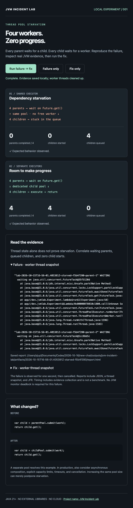
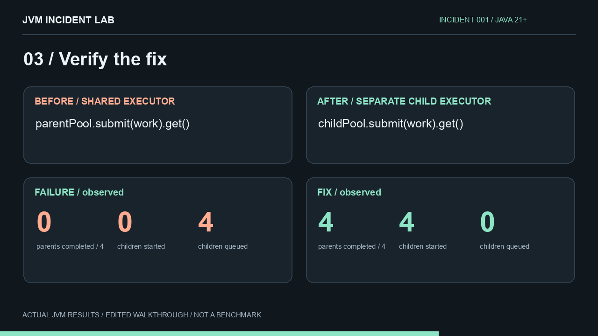

# JVM Incident Lab — Java 스레드 풀 고갈 재현 실습

**Java 스레드 풀 고갈을 재현하고, 스레드 덤프·JFR로 원인을 확인한 뒤 수정을 검증합니다.**

JVM Incident Lab은 **Java 동시성과 JVM 장애 분석을 직접 실습하는 오픈소스 도구**입니다. `ExecutorService`에서 `Future.get()`으로 대기하는 장애를 로컬에서 재현하고, 실제 스레드 덤프와 Java Flight Recorder(JFR) 기록으로 확인합니다. 자식 실행 풀을 분리한 수정 사례도 같은 조건에서 실행합니다.

Java 디버깅 학습, 스레드 덤프 분석 연습, 팀 장애 대응 교육에 사용할 수 있습니다. 대시보드와 오프라인 HTML 리포트는 한국어·영어를 지원합니다.

현재 버전은 스레드 풀 고갈 **한 가지 시나리오**를 제공합니다. 운영 시스템 분석 에이전트나 성능 벤치마크는 아닙니다.

<details>
<summary>실제 실행 화면 보기</summary>



</details>

[](docs/media/demo.mp4)

[30초 데모 보기](docs/media/demo.mp4) — 실제 실행 결과를 사용한 무음 편집 영상이며, 실시간 녹화나 성능 벤치마크가 아닙니다.

## 빠른 시작: Java 스레드 풀 고갈 재현

JDK 21 이상이 필요합니다. Maven·Gradle·DB·API 키·외부 Java 라이브러리는 필요하지 않습니다.

```sh
git clone https://github.com/angleCompany/jvm-incident-lab.git
cd jvm-incident-lab
./jvmlab
```

브라우저에서 **http://127.0.0.1:8787** 에 접속하고 **Run failure → fix**를 누르세요. 화면의 수치는 실제 JVM 실행에서 수집합니다.

대시보드와 오프라인 HTML 리포트의 **English / 한국어** 버튼으로 언어를 바꿀 수 있습니다. 처음에는 브라우저 언어를 따르며, 브라우저 저장 공간을 사용할 수 있으면 선택을 기억합니다. `?lang=ko` 또는 `?lang=en`으로 바로 열 수도 있습니다. 코드·원본 JVM 스택·JSON 필드명은 그대로 유지됩니다.

CLI로 비교하려면:

```sh
./jvmlab run compare
```

Windows는 JDK가 설치된 WSL에서 실행합니다.

## 무엇을 확인하나요?

| 관측값 | 동일 풀: 실패 | 자식 풀 분리: 수정 |
|---|---:|---:|
| 완료한 부모 작업 | 0 / 4 | 4 / 4 |
| 실행을 시작한 자식 | 0 | 4 |
| 대기 큐의 자식 | 4 | 0 |

네 부모가 모든 워커를 점유한 상태에서 같은 풀에 자식 작업을 넣고 `Future.get()`으로 기다립니다. 자식을 실행할 워커가 없어 진행이 멈춥니다. 수정 사례는 자식 전용 풀을 사용합니다.

실패 사례는 1초 동안 관측한 뒤 작업을 취소하고 풀 종료를 확인합니다. 관측 결과가 기대값과 다르면 성공으로 표시하지 않습니다. 이 현상은 JVM 모니터 데드락과 다릅니다. 풀 분리는 이 예제의 의존 관계를 해결하며, 모든 운영 환경에 통하는 처방은 아닙니다.

## 결과 파일

`artifacts/<실행 ID>/`에 다음 파일을 저장합니다.

- `report.html`: 오프라인으로 여는 독립 HTML 리포트
- `result.json`: 카운터와 기대 결과 충족 여부
- `threads.txt`: 정리 전 수집한 실험 워커의 실제 스택
- `recording.jfr`: 실습 JVM의 JFR 기록

수정 사례는 스택 수집 시점에 작업이 끝나 워커가 이미 쉬고 있을 수 있습니다. 완료 카운터와 함께 해석하세요. 실행 시간은 증거 수집 비용을 포함하므로 성능 비교에 쓰면 안 됩니다.

## 검증

JDK와 Python 3.10 이상에서 실행합니다.

```sh
python3 tests/verify.py
```

반복 실행, 기대 증상, JFR 내용, HTTP 오류, 동시 실행 거절, 후속 실행 성공을 검사합니다.

구조·Docker CLI·추가 옵션은 [영문 README](README.md), 장애 풀이 과정은 [시나리오 가이드](docs/thread-pool-starvation.md)를 참고하세요.

## 첫 실행 피드백

README만 보고 실패·수정 비교를 실행한 뒤, 실패 증거 하나와 무엇을 바꿨는지 설명해보세요. 막히면 5분 뒤 중단해도 됩니다.

[첫 실행 피드백 남기기](https://github.com/angleCompany/jvm-incident-lab/issues/new?template=first-run-feedback.yml). 시작하지 못한 경우도 도움이 됩니다.

[5인 사용자 검증 계획](docs/first-run-study.md)은 준비했으며, 외부 사용자 결과는 아직 수집하지 않았습니다.

## 자주 묻는 질문

### Future.get()에서 왜 작업이 멈추나요?

부모 작업이 같은 실행 풀에 자식을 넣고 기다릴 때, 모든 워커가 부모 작업에 점유되어 있으면 자식을 실행할 워커가 없습니다. 첫 시나리오는 워커 네 개와 부모 네 개로 이 의존 관계를 재현합니다.

### JVM 모니터 데드락과 같은 현상인가요?

이 예제는 모니터 락 순환이 아니라 실행 용량에 대한 의존 문제입니다. 스레드 상태와 함께 부모의 대기, 자식 대기 큐, 자식 실행 수를 확인해야 합니다.

### 기존 JVM 진단 도구와 어떻게 함께 쓰나요?

이 도구가 생성한 스레드 스택과 JFR을 JDK Mission Control(JMC) 등으로 살펴볼 수 있습니다. Arthas나 async-profiler처럼 임의의 운영 JVM을 진단하는 도구를 대체하지 않습니다.

실행 가능한 Java 장애 분석 실습이 유용했다면 **Star로 저장**해두세요. 실행 피드백과 재현 가능한 새 시나리오 기여도 환영합니다.
